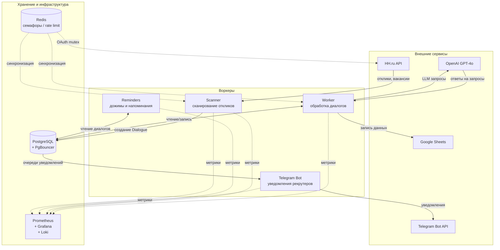

# AI Agent для HeadHunter

Асинхронная система автоматизации рекрутинга, взаимодействующая с кандидатами через диалоги на базе LLM (GPT-4o). Автоматически обрабатывает отклики, ведёт переговоры, организует собеседования и рассылает уведомления рекрутерам.

## Возможности

- **Автоматический сканер откликов** — непрерывный мониторинг HH API, синхронизация вакансий, обработка новых откликов в реальном времени
- **LLM-обработка диалогов** — GPT-4o-mini ведёт переговоры с кандидатами, квалифицирует, отвечает на вопросы, определяет намерения
- **Интеллектуальные напоминания** — многоуровневая система «дожимов» для молчунов (6 уровней), уведомления о предстоящих собеседованиях, follow-up после интервью
- **Аудит и верификация** — проверка возраста, гражданства, ограничений здоровья и языка через GPT-4o, аудит согласованных дат
- **Фаззинг-матчинг** — нечёткий поиск станций метро и адресов для сопоставления кандидатов с вакансиями
- **Google Sheets** — автоматическая запись данных кандидатов и транскрипций диалогов
- **Мониторинг и observability** — Prometheus-метрики, Sentry-трекинг ошибок, Loki-логи с возможностью поиска в Grafana

## Архитектура

Система построена на асинхронном воркер-ориентированном паттерне с разделением ответственности между специализированными компонентами.

### Общая схема



### Потоки данных

| Компонент | Роль |
|-----------|------|
| **Scanner** | Опрос HH API, синхронизация вакансий, перевод откликов из папки `response` в `consider`, создание записей `Candidate`/`Dialogue` в БД |
| **Worker** | Обработка `pending_messages` из диалогов, вызов LLM, парсинг намерений (квалификация/отказ/собеседование), отправка ответов кандидатам |
| **Reminders** | Рассылка дожимов молчунам, напоминания о собеседованиях (за 2ч / за 1д / утром в день), follow-up-цепочки после интервью |
| **Telegram Bot** | Внутренний интерфейс для рекрутеров: уведомления из очередей, транскрипции диалогов, управление пользователями/рекрутерами/балансами, экспорт статистики |

## Состояния диалогов

Жизненный цикл диалога кандидата:

```
initial_processing → information → negotiation → interview_scheduling → interview_assigned
                                                                        ↓
                                                   timed_out ←── reactivation ──┘
                                                        ↓
                                                   rejected / closed
```

## Стек технологий

| Категория | Технология |
|-----------|-----------|
| **Язык** | Python 3.11 (async/await) |
| **LLM** | OpenAI API (GPT-4o-mini, GPT-4o) |
| **БД** | PostgreSQL + PgBouncer (transaction pooling) |
| **ORM** | SQLAlchemy (asyncpg / psycopg2) |
| **Кэш/синхронизация** | Redis (distributed semaphores, rate limiting, mutex) |
| **Telegram** | aiogram 3.x |
| **Google** | Google Sheets API (gspread) |
| **Мониторинг** | Prometheus, Grafana, Loki, Promtail |
| **Трекинг ошибок** | Sentry |
| **Контейнеризация** | Docker, Docker Compose (multi-stage build) |

## Распределённая синхронизация

Система использует Redis для координации параллельных процессов:

- **Distributed Semaphore** — ограничение concurrent-запросов к LLM и HH API
- **Distributed Rate Limiter** — скользящее окно (100 req/s для HH API, 25 req/60s для Google Sheets)
- **Mutex** — защита обновления OAuth-токенов HH от race condition

## Наблюдаемость

Prometheus-метрики на порту `:8000` каждого воркера:

| Метрика | Описание |
|---------|----------|
| `hh_bot_new_responses_total` | Новые отклики обработаны |
| `hh_bot_messages_sent_total` | Сообщения отправлены кандидатам |
| `hh_bot_llm_tokens_total` / `hh_bot_llm_cost_total` | Использование и стоимость LLM |
| `hh_bot_e2e_response_latency_seconds` | E2E-задержка (от ответа кандидата до ответа агента) |
| `hh_bot_pending_dialogues_count` | Диалоги в очереди на обработку |
| `hh_bot_errors_total` | Счётчик ошибок |

## Структура проекта

```
.
├── run_hh_scanner.py          # Сканер откликов HH
├── run_hh_worker.py           # Воркер обработки диалогов + LLM
├── run_reminders_worker.py    # Воркер напоминаний и дожимов
├── run_telegram_bot.py        # Telegram-бот (admin UI + уведомления)
│
└── hr_bot/
    ├── db/
    │   ├── models.py           # 16 ORM-моделей (Dialogue, Candidate, Vacancy, AnalyticsEvent...)
    │   └── statistics_manager.py
    ├── services/
    │   ├── hh_api_real.py      # Обёртка над HH API (OAuth, пагинация, rate limit)
    │   ├── llm_handler.py      # OpenAI API (retry, семфоры, логирование токенов)
    │   ├── google_sheets_manager.py
    │   ├── knowledge_base.py   # Чтение Google Docs (промты вакансий)
    │   ├── sbor_google_service.py
    │   └── interview_reminder_manager.py
    ├── tg_bot/
    │   ├── handlers/           # FSM-обработчики (admin/user/common)
    │   ├── middlewares.py
    │   └── filters.py
    └── utils/
        ├── redis_lock.py       # Distributed Semaphore, Rate Limiter, Mutex
        ├── metrics.py          # Prometheus-метрики
        ├── analytics.py        # Событийная аналитика (event sourcing)
        ├── fuzzy_matcher.py    # Fuzzy-поиск метро и адресов
        ├── pii_masker.py       # Маскировка ПДн
        ├── system_notifier.py  # Системные алерты
        └── data_verification_notifier.py
```

## Развёртывание

Две конфигурации Docker Compose:

| Файл | Инстанция |
|------|-----------|
| `docker-compose.yml` | Общая — один сканер и воркер на все вакансии |
| `docker-compose_VV.yml` | ВкусВилл — 14 групп сканеров/воркеров, поделённых по рекрутерам |

Каждая инстанция изолирована: свой PgBouncer, стек мониторинга (Loki/Grafana/Prometheus на разных портах).
